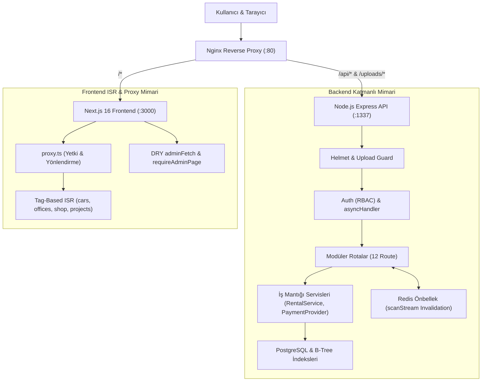

# VisionArc - Kurumsal Ekosistem & Yönetim Platformu

> E-ticaret, Araç Kiralama (Rent A Car) ve Medya Prodüksiyon hizmetlerini tek bir yüksek performanslı mimaride birleştiren, kurumsal seviyede modern bir ekosistem yönetim platformu.

---

## 🚀 Temel Özellikler

- **Çoklu Hizmet Mimarisi**: Tek bir uygulamadan Araç Kiralama, E-Ticaret Pazar Yeri ve Medya Prodüksiyon sektörlerine birleşik erişim.
- **Yüksek Performanslı Araç Kiralama**: Müsaitlik kontrolü, anlık rezervasyon, süre uzatma, erken iade hesaplama ve şube/ofis transferi.
- **E-Ticaret & Pazaryeri Entegrasyonu**: Trendyol, Hepsiburada ve N11 yönlendirmeli dinamik ürün kataloglama, filtreleme ve arama.
- **Prodüksiyon & Medya Portfolyosu**: YouTube ve yerel video oynatma desteğine sahip, klavye ve modal erişilebilir medya vitrini.
- **Kapsamlı Yönetici Paneli (Admin Dashboard)**: Kiralamalar, araç filosu, şubeler, kullanıcılar, roller & izinler (RBAC), muhasebe/finans raporları ve destek talepleri yönetimi.
- **Mobil Uyumlu Yönetim Arayüzü**: Tablet ve mobil ekranlar için açılır çekmece (slide-over drawer) yan menü desteği.
- **Çok Katmanlı Önbellek & Yüksek Hız**: Redis önbellekleme (non-blocking `scanStream` ile temizleme) ve Next.js 16 Tag-Based ISR.
- **Temiz & Modüler Mimari (Clean Architecture)**: Sıfır N+1 sorgu darboğazı, B-Tree indeksli PostgreSQL ve Controller-Service katman ayrımı.
- **Çoklu Ödeme Sağlayıcı Altyapısı**: Strategy Pattern ile tasarlanmış Iyzico, Stripe ve HMAC doğrulamalı Test (Dummy) ödeme sağlayıcı desteği.
- **Sertleştirilmiş Güvenlik (Hardened Security)**: Helmet HTTP başlıkları, güvenli çerez yapılandırması (`secure: true`), imza doğrulamalı JWT oturumları (`jose`), katı dosya yükleme uzantı ve boyut koruması.
- **Konteynerizasyon**: Çok aşamalı (multi-stage) standalone Next.js ve yetkisiz (non-root) Express Docker Compose mimarisi.

---

## 🛠️ Teknoloji Yığını (Tech Stack)

### **Frontend:**
- **Framework:** [Next.js 16.4.5](https://nextjs.org/) (App Router, Standalone Output, Server Actions)
- **Kütüphane:** [React 19.3.1](https://react.dev/)
- **Stil & Tasarım:** [Tailwind CSS v4.3.4](https://tailwindcss.com/), Google Fonts (Inter & Outfit), Material Symbols
- **Animasyon:** [Framer Motion 12.43](https://www.framer.com/motion/)
- **Yetkilendirme & Güvenlik:** `jose` (HMAC-SHA256 JWT doğrulama), `proxy.ts` (Next.js 16 standart vekil katmanı)
- **Dil:** TypeScript 5 (Strict mod)

### **Backend:**
- **Çalışma Ortamı:** [Node.js 22 LTS](https://nodejs.org/) & [Express 4.21](https://expressjs.com/) (TypeScript)
- **Veritabanı:** [PostgreSQL 15](https://www.postgresql.org/) (B-Tree indeksler ve bağlantı havuzu)
- **Önbellek:** [Redis 7](https://redis.io/) (Non-blocking `scanStream` ile mutasyon bazlı temizleme)
- **Güvenlik Başlıkları:** `helmet` 8.3
- **Kimlik Doğrulama:** JWT, bcryptjs, Google OAuth 2.0
- **E-posta:** Nodemailer 10.3.1 (SMTP entegrasyonu)

### **Altyapı & DevOps:**
- **Reverse Proxy:** Nginx (API, Uploads ve Frontend ters vekil sunucusu, `nosniff`, 200MB upload sınırı)
- **Konteynerizasyon:** Docker & Docker Compose (Canlı ve Geliştirme ortamları)

---

## 🏗️ Mimari & Performans İyileştirmeleri



### ⚡ Öne Çıkan Optimizasyonlar
1. **Sıfır N+1 Darboğazı:** Kiralama ve araç listeleme sorguları tekil `LEFT JOIN` SQL sorgularına dönüştürüldü; gecikme %95+ azaltıldı.
2. **PostgreSQL B-Tree İndeksleri:** Foreign key (`rental_id`, `car_id`, `user_id`), kiralama durumları, ofis ve araç müsaitlik filtrelerine indeksler eklendi.
3. **KVKK ve PII Koruması:** `GET /api/rentals` public uç noktası daraltılarak müşteri e-posta, telefon ve isim bilgileri kaldırıldı; yalnızca müsaitlik tarihleri dönecek hale getirildi.
4. **Güvenli Dosya Yükleme:** RAM tükenmesini ve XSS saldırılarını önlemek için dosya boyutu sınırı (`MAX_UPLOAD_MB`) ve katı uzantı whitelist'i (`.jpg`, `.png`, `.webp`, `.mp4`, `.pdf` vb.) uygulandı.
5. **Kriptografik Token Doğrulaması:** Frontend admin paneli geçişlerinde `jose` kütüphanesi ile HMAC-SHA256 imza kontrolü zorunlu kılındı.
6. **Non-blocking Redis SCAN:** Tek iş parçacıklı Redis olay döngüsünü kitleyen `KEYS` çağrıları kaldırıldı; `scanStream` ile asenkron temizleme mimarisine geçildi.

---

## ⚡ Hızlı Kurulum (Docker ile)

Sistemi çalıştırmanın en kolay ve güvenli yolu Docker Compose kullanmaktır.

### 1. Ortam Değişkenlerini Ayarlayın
Kök dizindeki `.env.example` dosyasını kopyalayarak `.env` dosyanızı oluşturun:
```bash
cp .env.example .env
```
Canlı ortama almadan önce `JWT_SECRET`, `ADMIN_JWT_SECRET`, `PAYMENT_WEBHOOK_SECRET` ve veritabanı şifrelerini güncelleyin.

### 2. Canlı (Production) Modda Başlatma
```bash
docker compose up -d --build
```
- **Web Uygulaması (Frontend):** `http://localhost:3000` veya Nginx üzerinden `http://localhost`
- **Backend API:** `http://localhost:1337/api` (Sağlık kontrolü: `/api/health`)

### 3. Geliştirme (Development Hot-Reload) Modunda Başlatma
Kaynak kodu anlık olarak izlemek ve bağımlılıkları bağlamak için dev override dosyasını kullanın:
```bash
docker compose -f docker-compose.yml -f docker-compose.dev.yml up
```

### 4. Konteynerleri Durdurma
```bash
docker compose down
```

---

## 💻 Manuel Yerel Kurulum (Docker Olmadan)

### Gereksinimler:
- Node.js v20+ ve npm
- PostgreSQL 15+
- Redis 7+

### Backend'i Başlatma:
```bash
cd backend
npm install
npm run dev
```

### Frontend'i Başlatma:
```bash
cd frontend
npm install
npm run dev
```

---

## 🧪 Otomatik Testler

Proje genelinde sıfır harici bağımlılıkla yerleşik `node:test` altyapısı kullanılmıştır.

### Backend Güvenlik ve Regresyon Testleri:
```bash
cd backend
npm test
```
- `/api/health` ve Helmet başlıkları
- Sabit `?secret=` yetki bypass'ının engellenmesi (S1)
- Yetkisiz `/api/cars` yazma koruması (S2)
- `GET /api/rentals` PII gizlilik doğrulaması (S3)
- Sahte ödeme webhook'u ve imza doğrulaması (S4)
- Medya yükleme boyut ve uzantı whitelist kontrolü (S5)
- `buildUpdateQuery` dinamik SQL enjeksiyon koruması

### Frontend JWT ve Yetkilendirme Testleri:
```bash
cd frontend
npm test
```
- Geçerli HMAC-SHA256 admin JWT imzasının doğrulanması
- İmzası doğrulanmamış veya sahte base64 tokenların reddedilmesi
- Süresi dolmuş tokenların engellenmesi

---

## 🔒 Varsayılan Yönetici Girişi

İlk kurulumda varsayılan Süper Yönetici hesabı tanımlanır:

- **Panel Adresi:** `http://localhost:3000/admin/login`
- **E-posta:** `admin@example.com`
- **Şifre:** `admin123456`

> [!IMPORTANT]
> Güvenliğiniz için canlı ortama (production) almadan önce yönetim panelinden şifrenizi güncelleyin ve `.env` içerisindeki gizli anahtarları rastgele güçlü dizgilerle değiştirin.

---

## 💳 Ödeme Altyapısı (Payment Provider Pattern)

Ödeme sağlayıcıları Strategy Pattern ile tek noktadan yönetilir (`PaymentProvider.ts`):

1. **DummyProvider:** HMAC-SHA256 imzalı güvenli test akışı.
2. **IyzicoProvider:** Iyzico API altyapısı için hazır iskelet (anahtarlar tanımlanana kadar güvenli şekilde kapalıdır).
3. **StripeProvider:** Stripe Checkout altyapısı için hazır iskelet.

Aktif sağlayıcı sunucu ortam değişkeniyle (`PAYMENT_PROVIDER`) belirlenir:
```env
PAYMENT_PROVIDER=dummy # veya stripe / iyzico
PAYMENT_WEBHOOK_SECRET=guvenli-webhook-anahtariniz
```

---

## 📄 Lisans

Bu proje MIT Lisansı ile lisanslanmıştır. Detaylar için [LICENSE](LICENSE) dosyasını inceleyebilirsiniz.
